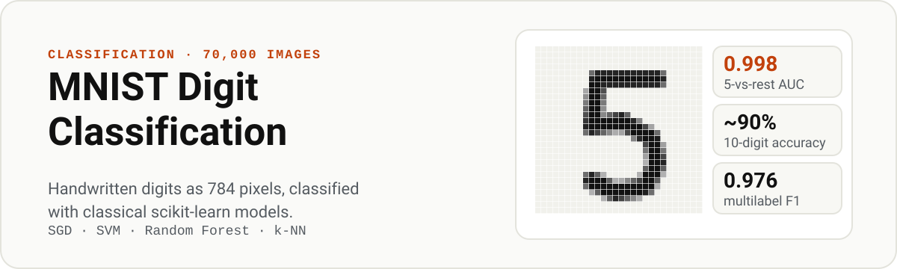

<p align="center">
  
</p>

<p align="center">
  <a href="#results"><b>Results</b></a> &nbsp;·&nbsp; <a href="#what-the-notebook-covers"><b>What it covers</b></a>
</p>

Handwritten digit classification on MNIST-784 (70,000 images of 28 x 28 pixels, flattened to 784 features) with classical scikit-learn models. The notebook works through the full classification toolkit: binary and multiclass classifiers, cross-validation, precision and recall trade-offs, ROC curves, error analysis, and multilabel and multioutput classification.

## Results

All numbers are 3-fold cross-validation on the 60,000 training images.

**Binary task: "is this digit a 5?"**

| Model | Metric | Score |
|:--|:--|:--|
| SGD classifier | Accuracy | 0.950 to 0.960 |
| SGD classifier | Precision / Recall / F1 | 0.837 / 0.651 / 0.733 |
| SGD classifier, threshold tuned for 90% precision | Precision / Recall | 0.900 / 0.480 |
| SGD classifier | ROC-AUC | 0.960 |
| **Random Forest** | **ROC-AUC** | **0.998** |

**Multiclass task: all 10 digits**

| Model | Accuracy |
|:--|:--|
| SGD classifier, raw pixels | 0.859 to 0.874 |
| **SGD classifier, standardised pixels** | **0.891 to 0.902** |

**Multilabel task: "is the digit 7 or larger?" and "is it odd?"**

| Model | Macro F1 |
|:--|:--|
| k-nearest neighbours | **0.976** |

## What the notebook covers

- **Loading:** MNIST via `fetch_openml`, 60,000 / 10,000 train-test split
- **Binary classification:** an SGD "5 detector" trained and scored with cross-validation
- **Precision vs recall:** confusion matrix, precision-recall curve, choosing a threshold for 90% precision
- **ROC curves:** SGD compared with Random Forest
- **Multiclass:** SVC (one-vs-one), one-vs-rest SVC and SGD, with feature scaling
- **Error analysis:** a normalised confusion matrix, showing that 8s and 3/5 confusions dominate the errors
- **Multilabel and multioutput:** k-NN for two labels at once, and a denoising model that cleans noisy digit images

## Run it

```bash
pip install numpy matplotlib scikit-learn jupyter
jupyter notebook Classification.ipynb
```

The SVC cells train on all 60,000 images and take several minutes on a laptop.

## Files

| File | Purpose |
|:--|:--|
| `Classification.ipynb` | The full workflow, from data loading to multioutput classification |

## Next steps

- A small CNN in PyTorch, which typically reaches 99% or more on MNIST
- Hyperparameter search for the SVC and k-NN models
- Data augmentation by shifting images a pixel in each direction

---

<sub>Built by [Aryan Awasthi](https://github.com/Techy-A). ENC @ Thapar Institute of Engineering and Technology.</sub>
